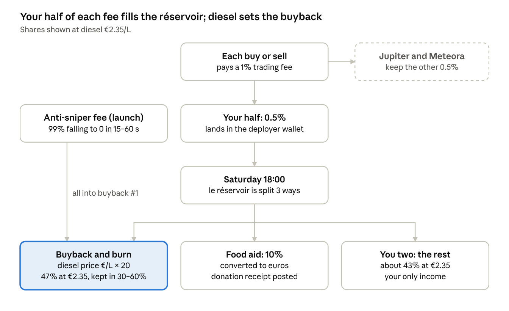

# $PLEIN — launch playbook

16 October 2026 · launch playbook, exported from the Claude Docs original.

> **Partly superseded — read with [`thesis.md`](thesis.md) and [`../CLAUDE.md`](../CLAUDE.md).**
> - **Look:** the hi-vis yellow and reflective bands described below were dropped. The brand is now *La Station* (night petrol station, LED totem, motorway signage); see `thesis.md` and `design/`.
> - **Diesel figure:** written with the 2 October survey (€2.356/L). The 9 October survey (€2.3283/L → 46.6 %) is now the latest; the site reads `public/config.js`.
> - **Liquidity lock:** "locked for good" below is not verified. Check the real lock on-chain after the pool migrates before saying it anywhere.
> - **Fee claims on Jupiter Studio:** unverified path (see `research-2026-10-16.md`, "Fee claims"). Test with a small amount first.

## Bottom line

Launch **$PLEIN** on Jupiter Studio on Saturday 17 October at 18:00 Paris time, from a separate coin account. The meme is the price at the pump: diesel averaged €2.36/L in the week of 2 October, and that Saturday is a national protest against the cost of living.

- **The economy:** every trade pays a 1% fee, and half of it (0.5%) comes to you. Each Saturday that pot, *le réservoir*, is split three ways: a buyback-and-burn sized by the official diesel price (price × 20, so 47% at €2.35), 10% to food aid, and the rest (about 43%) to you two.
- **Snipers pay for the first fill-up:** Jupiter's anti-sniper fee (99%, falling to 0 within 15–60 seconds) goes to the creator. You put all of it into buyback #1.
- **You earn from fees, not from dumping:** no team allocation and no hidden dev buy. At €2M of trading volume your half of the fees is about €10k: €4.7k buyback, €1k food aid, €4.3k for you two.
- **What holders get:** a weekly buyback they can verify on-chain, no insider bag to fear, and a reason to come back every Saturday. It is not a yield, and the price can still go to zero.
- **Attention:** a petrol-station price-sign meme, receipts every Saturday, an AI pump-attendant bot, and a public self-audit of your own launch with your SOL OS engine.
- **Before you press the button:** EU crypto rules (MiCA) and the 2023 French influencer law apply to you (section 10). Never pay French influencers, never run a raffle, never promise returns.

## The concept

**$PLEIN** ("le plein", a full tank) turns the country's most shared pain point into a weekly ritual: when diesel goes up, the coin buys itself back harder. The tagline is **« Quand le gazole monte, $PLEIN rachète. »**

Why the timing works:

- **Saturday 17 October** is a national day of action against the cost of living. It was started by gilets jaunes collectives and joined by CGT, Solidaires, student unions, LFI and the PCF. Organisers list more than 1,300 actions; the Interior Minister expects about 250 ([Euronews](https://fr.euronews.com/2026/10/16/mobilisation-du-17-octobre-qui-manifestera-en-france-et-quelle-ampleur-attendre)).
- **Fuel is the story.** Diesel averaged €2.36/L in the week of 2 October (DGEC). The government is releasing 10 million barrels of strategic diesel stocks, but the expected 12–18 cent drop is only due at the pump from about 1 November ([Kelwatt](https://www.kelwatt.fr/actu/10-millions-barils-diesel-baisse-prix-gazole-octobre-2026)).
- **The topic lasts beyond one day:** strikes threaten flights from 17 to 21 October ([Ulysse](https://ulysse.com/news/alerte-voyageurs-une-greve-nationale-menace-les-vols-en-france-du-17-au-21-octobre-2026)), and the price drop gives you a second moment in early November.

**Positioning:** $PLEIN is a meme about the price at the pump, not a protest token. It does not speak for the gilets jaunes, a union or a party, and it uses no real person's face and no fuel brand. That keeps it shareable by everyone who fills a tank, and keeps you clear of political and image-rights trouble.

**Look:** hi-vis yellow on asphalt black, with reflective bands that nod to the vest without using it. The signature object is the LED price sign that stands outside every petrol station.

## The economy



Half of every trade fee is yours. Once a week you split it in public, and the diesel price decides the biggest share.

```math
\text{buyback share} = 20 \times \text{diesel price in euros per litre}, \quad \text{kept between } 30\% \text{ and } 60\%
```

- **Which price:** the latest official weekly national average for diesel (DGEC), read on Saturday at noon. It was €2.36 in the week of 2 October.
- **Why ×20 and not ×25:** at €2.35, ×25 would send 59% to the buyback and leave you too little. ×20 gives 47%, and the 30–60% band keeps it sane if prices swing.
- **Buyback:** a market buy of $PLEIN from the réservoir wallet, then a burn of everything bought. Both transactions are posted.
- **Food aid:** 10% converted to euros and given to one association agreed in advance; the receipt is posted.
- **You two:** what's left, about 43% this week, paid to your published wallets. No allocation, no presale, nothing else.
- **Anti-sniper fee:** collected once at launch and added in full to buyback #1.

## What the economy can and cannot do

The buyback moves money from traders to holders; it does not create money. Every euro it spends comes out of the 1% fee that buyers and sellers already paid.

| First-month volume | Your half of fees (0.5%) | Buyback & burn (47%) | Food aid (10%) | You two (43%) |
| --- | --- | --- | --- | --- |
| €100k | €500 | €235 | €50 | €215 |
| €2M | €10,000 | €4,700 | €1,000 | €4,300 |
| €20M | €100,000 | €47,000 | €10,000 | €43,000 |

Shares at diesel €2.35/L. Anti-sniper fees come on top, all into buyback #1; their size is unknown until launch.

- **Volume is the whole business.** Most memecoins do most of their volume in the first days, then fade. Plan around the €100k row and treat the others as upside.
- **A buyback matters when it is large next to the market cap.** €4.7k a week is felt on a €1M coin; on a €20M coin it is noise.
- **It is not a yield, a dividend or a right.** Say so on the site: promising returns is what turns a meme into a regulatory problem.
- **What protects holders most is what you don't do.** On the Robinhood Chain coins we traced this week, insiders held 78–98% of supply and about $160k of liquidity sat behind $11M market caps. Every one of them fell to about €2.5k when the insiders sold.

## Launch on Jupiter Studio

Jupiter Studio fits this economy best. Creators get half of the 1% fee before and after graduation, the anti-sniper fee goes to the creator, and at graduation the liquidity moves to a Meteora pool whose LP is locked for good ([Jupiter docs](https://docs.jup.ag/user-docs/launch/studio)).

| Setting | Value | Why |
| --- | --- | --- |
| Mode | Meme (preset) | Anti-sniper on, no vesting, nothing to misconfigure |
| Quote currency | USDC | Fees arrive in dollars, so the weekly split and the donation are easy to count |
| Market cap at start → graduation | 5,000 → 75,000 USDC | About 15,390 USDC raised before migration |
| Supply | 1,000,000,000, fixed | 79% sold on the curve, 21% paired in the pool at graduation |
| Anti-sniper | On: 99%, falling to 0 within 15–60 s | Paid to you; 100% goes to buyback #1 |
| Team allocation | 0% | Your income is the fee share |
| Dev buy | None during the anti-sniper window | You would pay the fee to yourself, an edge buyers will spot |

Settings from [Jupiter's launch guide](https://docs.jup.ag/user-docs/launch/studio/launching-a-token.md); check the fee split shown in the Studio screen before you sign.

- **Token page:** name *Le Plein*, ticker *PLEIN*, the price-sign logo, links to the site, X and Telegram. Description: « Quand le gazole monte, $PLEIN rachète. Chaque samedi 18h : rachat et burn indexés sur le prix officiel du gazole, 10 % des frais à l'aide alimentaire. Memecoin, aucune promesse de rendement. »
- **Wallets, all fresh and all published:** the deployer (launches the coin, receives the fees), *le réservoir* (buys back and burns), *l'aide* (holds the food-aid share until it is converted to euros), and one wallet each for you two.
- **If you want tokens yourselves:** buy after the anti-sniper window, at market, from a labelled wallet, and write your selling rule on the site.

**Why not the others:**

- **pump.fun** has the most traffic, but the creator fee falls from 0.95% (at $88k–$300k market cap) toward 0.05% by $20M ([Decrypt](https://decrypt.co/337872/pump-funs-new-fee-model-hands-out-2m-to-creators-in-first-24-hours)), and there is no sniper protection. Pick it only if reach matters more than the economy.
- **Bags** pays creators 1% (0.75% after graduation), but traders pay 2% in total, which slows the volume the model lives on ([Bags docs](https://docs.bags.fm/how-to-guides/customize-token-fees)).

## Launch run-sheet (Paris time)

Everything below fits in one evening and one Saturday. The contract address appears nowhere before 18:00.

**Friday 16 October, tonight**

- [ ] Reserve the coin's X handle and a Telegram group; post only the teaser.
- [ ] Create the fresh wallets (deployer, réservoir, aide) and put about 0.1 SOL in the deployer for fees.
- [ ] Buy the domain and put the site online with "Contrat : 18h" in place of the address.
- [ ] Export the logo, banner and launch visuals from the design kit; write the pinned post.
- [ ] Pick the food-aid association and ask it whether it accepts the donation and being named.
- [ ] Settle section 10: launch through a company or not.

**Saturday 17 October**

- [ ] 09:00 Teaser: the price sign at €2.35 and « 18h, on ouvre le réservoir. »
- [ ] 10:00–17:00 One fuel-price post every 2 hours. Fuel hashtags only, never the protest ones.
- [ ] 17:45 Final check in Studio: Meme mode, USDC, anti-sniper on, image, links.
- [ ] 18:00 Launch. Post the address on X, Telegram and the site at the same minute.
- [ ] 18:05 Post the launch transaction, the published wallets and « 0 % équipe ».
- [ ] 19:00 Publish the self-audit: top holders, any bundled wallets, sniper fees collected.
- [ ] 21:00 Thread explaining the réservoir; open the "Montre ton ticket" contest.

**Sunday 18 October**

- [ ] Recap post: holders, volume, sniper fees. Answer every question in the replies.

**Saturday 24 October, 18:00: Plein #1**

- [ ] Claim the creator fees and read the latest official diesel price.
- [ ] Compute the split, buy back and burn, send the food-aid share.
- [ ] Post every transaction link and the donation receipt as a "ticket de caisse".

## Attention plan

The hook is a real number that changes every week. Every post puts the price at the pump next to what $PLEIN does with it.

1. **The price sign.** An LED sign like the ones outside every station: « GAZOLE 2,346 · RACHAT 47 % ». It is the logo, the banner and the daily meme template.
2. **« Snipe-nous, tu paies le plein. »** Announce the launch time openly. Any sniper's fee lands in buyback #1, and you post the total.
3. **Plein #N, every Saturday at 18:00.** A receipt-style post with the diesel price, the share bought back, tokens burned, the food-aid amount and every transaction link.
4. **Le Pompiste, an AI bot.** A small agent on the coin's account reads the official price and the réservoir wallet, then posts the sign and the tank gauge. Your AI skill, shown without your name on it.
5. **The self-audit.** One hour after launch, publish what your SOL OS engine sees on your own coin: holders, bundles, sniper fees. Almost nobody audits their own launch in public.
6. **« Montre ton ticket. »** People post their fuel receipt with $PLEIN. The best ones, judged on creativity and open to anyone without buying, win a prize paid from your share.
7. **The calendar.** 17 October protests, flight strikes until 21 October, the expected drop at the pump around 1 November: each one is a post, not a campaign.

**What never to do:** pay French influencers or "callers" (section 10), run raffles, spam protest hashtags, fake volume with your own wallets, or post the coin from your personal account.

## Website

The site is drawn in the [$PLEIN launch kit](https://claude.ai/artifact/PVtLUSBLhbDsgPPY1jQS7F): one page in French, desktop and phone, with the price sign as the hero and a slider that shows the weekly split for any diesel price.

1. **Hero:** « Quand le gazole monte, $PLEIN rachète. », the buy button, the contract box ("publié samedi à 18:00", then the address) and the price sign.
2. **Le réservoir:** the tank gauge, fills done, tokens burned, food aid paid, team allocation 0%.
3. **Comment ça marche:** the three weekly steps.
4. **La répartition:** the diesel slider and the three-way bar.
5. **Snipe-nous:** the anti-sniper promise.
6. **Transparence:** every wallet and five commitments.
7. **Historique des pleins:** one row per Saturday, with its proofs.
8. **FAQ and legal notice:** no rights, no advice, no affiliation with any movement or fuel brand.

**Before it goes live:** replace the bracketed placeholders (X handle, Telegram link) and add the contract address at 18:00. After that, three things change each Saturday: the réservoir numbers, the history row and the price sign.

**Putting it online:** export the page from the canvas, or I turn it into a standalone page and deploy it on your Vercel tonight. Then point a short domain at it and put the same link on the token page, X and Telegram.

## Legal and tax in France, to check with a lawyer

I'm not a lawyer. These are the points a lawyer specialised in crypto should confirm, ideally before Saturday 18:00.

- **MiCA applies to offering a crypto-asset to the public in the EU.** The offeror must be a legal person ([MiCA Art. 4](https://www.springlex.eu/fr/packages/mica/mica-regulation/article-4/)). No white paper is needed under €1M raised over 12 months or under 150 people per country, but marketing must stay fair, clear and not misleading.
- **Announcing an exchange listing cancels those exemptions.** Never write "bientôt sur Binance". A white paper, if ever needed, is notified to the AMF at least 20 working days ahead, with a €3,000 fee ([AMF](https://www.amf-france.org/fr/espace-professionnels/fintech/mes-relations-avec-lamf/emission-admission-de-crypto-actifs)).
- **Whether a launchpad memecoin counts as an "offer" by its creator is not settled.** The cautious route is to launch through a company, yours or a new SAS.
- **The 2023 influencer law reserves paid crypto promotion to registered actors.** Breaches carry up to 2 years in prison and a €300,000 fine ([Cryptoast](https://cryptoast.fr/loi-influenceurs-commission-mixte-paritaire-approuve-proposition-revisee-unanimite/)). Don't pay anyone to push $PLEIN to a French audience.
- **A random prize for holders or buyers can be an illegal lottery.** Only skill-judged contests, open to everyone without buying.
- **No promise of profit**, anywhere: site, posts, Telegram, DMs.
- **Tax:** creator fees are income for whoever receives them; ask an accountant whether they go through a company. Personal gains from selling crypto above €305 of yearly sales are taxed at the flat tax, 30%, rising to 31.4% with the 2026 CSG increase ([Moneyvox](https://www.moneyvox.fr/impot/actualites/108257/impots-2026-une-hausse-de-la-csg-retroactive-qui-va-alourdir-la-revente-de-vos-cryptos)).
- **Images:** no real people, no fuel brands, no State logos such as Marianne.
- **Your new role:** read your company's rules on side projects and public communication before launch.

## Risks and kill switches

The likeliest outcome for any memecoin is low volume after the first days; plan the exit of attention, not just the launch.

| Risk | Early sign | What you do |
| --- | --- | --- |
| Copycats with the same ticker | Other "PLEIN" or "GAZOLE" coins on Saturday | Pin the one contract address everywhere; the weekly receipts are what a copy can't fake |
| Flop | Under €20k volume on day one | Keep the Saturday ritual for 4 weeks anyway; stop paying for anything |
| A whale or sniper dumps | One wallet over 5% of supply after launch | Name it in the self-audit; the buyback keeps running on schedule |
| The tone turns | Violence at the protests dominates the news | Pause posting for the day; never meme injuries or clashes |
| Deployer key leaks | Any transaction you didn't sign | Hardware wallet or fresh device; move claimed fees out weekly |
| A legal question arrives | Message from the AMF or a platform | Stop promotion, keep the receipts, call the lawyer |
| It ties back to your role | Your name next to the coin in replies | Coin account only; never answer from your personal account |

The falling diesel price is not a risk: the buyback share drops a little (€2.20/L gives 44%), and « le gazole baisse, ton plein coûte moins » is a post too.

## Sources

- [Euronews: who is marching on 17 October and how many](https://fr.euronews.com/2026/10/16/mobilisation-du-17-octobre-qui-manifestera-en-france-et-quelle-ampleur-attendre)
- [Kelwatt: diesel at €2.36/L (DGEC, week of 2 October) and the strategic stock release](https://www.kelwatt.fr/actu/10-millions-barils-diesel-baisse-prix-gazole-octobre-2026)
- [prix-carburant.eu: national averages on 12 October 2026](https://prix-carburant.eu/article/prix-carburants-2026-10-12)
- [Ulysse: flight-crew strike notice, 17–21 October](https://ulysse.com/news/alerte-voyageurs-une-greve-nationale-menace-les-vols-en-france-du-17-au-21-octobre-2026)
- [Jupiter Studio overview](https://docs.jup.ag/user-docs/launch/studio) and [launch settings](https://docs.jup.ag/user-docs/launch/studio/launching-a-token.md)
- [Decrypt: pump.fun dynamic creator fees](https://decrypt.co/337872/pump-funs-new-fee-model-hands-out-2m-to-creators-in-first-24-hours)
- [Bags docs: token fee modes](https://docs.bags.fm/how-to-guides/customize-token-fees)
- [MiCA Article 4 (French text)](https://www.springlex.eu/fr/packages/mica/mica-regulation/article-4/)
- [AMF: issuing crypto-assets under MiCA](https://www.amf-france.org/fr/espace-professionnels/fintech/mes-relations-avec-lamf/emission-admission-de-crypto-actifs)
- [Cryptoast: final influencer law, crypto promotion and penalties](https://cryptoast.fr/loi-influenceurs-commission-mixte-paritaire-approuve-proposition-revisee-unanimite/)
- [Moneyvox: 2026 CSG increase and the 31.4% flat tax](https://www.moneyvox.fr/impot/actualites/108257/impots-2026-une-hausse-de-la-csg-retroactive-qui-va-alourdir-la-revente-de-vos-cryptos)
- Robinhood Chain operator data: rhc-engine runs runners-009b and runners-010, 14 October 2026.
