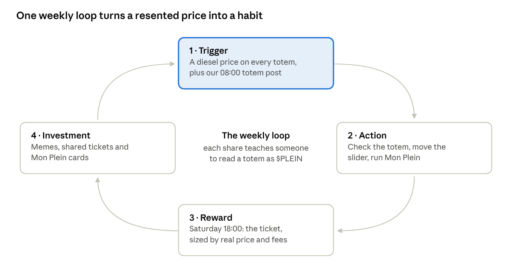
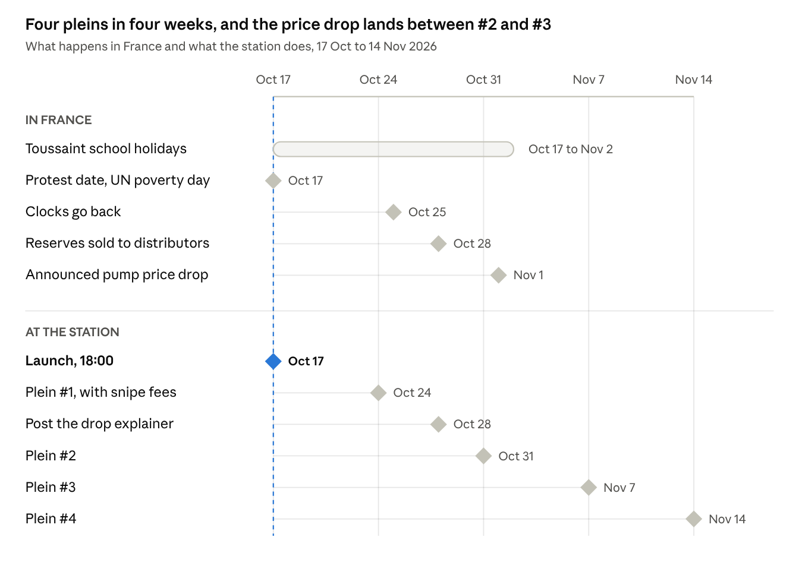

# La Station — the $PLEIN design thesis

16 October 2026 · design thesis, exported from the Claude Docs original.

> **Figures in this document are dated 16 October 2026.** It prices the buyback with the official diesel survey of 2 October (€2.356/L → 47.1 %). The survey of 9 October (€2.3283/L → 46.6 %) has since become the latest one; the site reads the current figure from `public/config.js`, never from this file. Claims are tiered in [`../CLAUDE.md`](../CLAUDE.md).

## The thesis on one page

**The $PLEIN site is a petrol station at night, the one place in France everyone still passes through whatever they vote, wired to a buyback anyone can check.** Its signature line is *« Un prix qu'on subit, un rachat qu'on vérifie. »* (A price we endure, a buyback we verify.)

- **The insight.** The pump counter is the most resented number in France this autumn: diesel around €2.35 a litre, a 50-litre fill near €117, and nothing anyone can do about it. $PLEIN cannot lower it. It gives that number a second job: the higher it goes, the bigger the share of fees that buys back and burns $PLEIN every Saturday at 18:00.
- **The reminder we never pay for.** Some 9,800 stations post a diesel price on a totem by the road every day. Each one reminds people of $PLEIN for free. That matters, because paying anyone to promote this coin has been illegal in France since 1 July 2026.
- **Three engines.** Ritual: the Saturday *plein* and its printed ticket. Utility: *Mon Plein*, a free cheapest-station finder for people who will never buy. Play: *L'Atelier*, a totem meme maker. Trust runs under all three: published wallets, on-chain tickets, a live self-audit, and commitments drawn as *lignes continues*, the solid road lines you never cross.
- **The pivot.** The old kit's hi-vis yellow and reflective band now read as gilet jaune, and 17 October is being covered as their return. Both are gone. A station is neutral ground; a vest is not.
- **The line.** No promised gains, no paid promotion, no purchase-tied draws, no political symbols, adults only. One sentence holds the site up: *« Ne mets jamais l'argent de ton plein dans $PLEIN. »* (Never put your fuel money into $PLEIN.)

## The moment

**On launch day, Saturday 17 October, France pays more for diesel than at any point before this year, starts its autumn school holidays, and faces a protest date born on TikTok.** Every design choice below answers one of these facts.

| Fact | Figure | When | Source |
| --- | --- | --- | --- |
| Diesel, official weekly average | €2.356 / L | week of 2 Oct 2026 | DGEC note, via [Kelwatt](https://www.kelwatt.fr/actu/baisse-petrole-prix-carburants-pompe-octobre-2026) |
| Diesel, live national average | €2.346 / L | 12 Oct 2026, 23:00 | [prix-carburant.eu](https://prix-carburant.eu/article/prix-carburants-2026-10-12) |
| SP95-E10, live national average | €2.147 / L | 12 Oct 2026, 23:00 | [prix-carburant.eu](https://prix-carburant.eu/article/prix-carburants-2026-10-12) |
| A 50-litre diesel fill | about €117 | 12 Oct 2026 | live average × 50 |
| Diesel at the March "historic record" | €2.19 / L | 31 Mar 2026 | BFM TV, via [Newsar](https://newsar.codejungle.org/articles/46123) |
| Diesel when the gilets jaunes began | €1.47 / L | 2018 | [lesvoitures.fr](https://lesvoitures.fr/gilets-jaunes-manifestation-17-octobre/) |

- **Diesel now costs about 20 cents more than petrol.** French drivers grew up with the opposite.
- **A drop is announced, and it will move our formula.** Prime Minister Sébastien Lecornu confirmed on 12 October that pump prices fall from 1 November, by 8 to 18 cents a litre. Ten million barrels of strategic reserves go to distributors from 28 October ([L'Automobiliste](https://lautomobiliste.fr/13/10/2026/gazole-la-baisse-des-prix-promise-des-le-1er-novembre-2026/)). TotalEnergies already caps diesel at €2.25 at its own stations ([Kelwatt](https://www.kelwatt.fr/actu/baisse-petrole-prix-carburants-pompe-octobre-2026)).
- **Saturday is the first day of the Toussaint holidays** in all three zones, through Monday 2 November ([iCalendrier](https://icalendrier.fr/vacances/toussaint)). A departure weekend is a fill-up weekend.
- **17 October is also a protest date.** The call grew from a TikTok video with 295,000 likes and 29,000 shares in nine days. Nobody claims it, no union has endorsed it, and AI-made posts address it to "tous les Gilets jaunes" ([Public Sénat](https://www.publicsenat.fr/actualites/societe/appel-a-manifester-le-17-octobre-y-a-t-il-une-realite-derriere-cette-tendance-des-reseaux-sociaux), 18 Sep). Several party leaders have backed it.
- **17 October is also the UN International Day for the Eradication of Poverty.** It gives the 10% food-aid share a date that belongs to no party.
- **The audience is curious, not converted.** 10% of French people say they hold crypto, down from 12%, and a third say they would consider buying ([Journal du Coin](https://journalducoin.com/actualites/1-francais-sur-10-detient-crypto-selon-rapport-annuel-adan/) on the ADAN 2025 study).
- **Paying for promotion is off the table.** Since 1 July 2026, article 4 V of law 2023-451 bans paid promotion of crypto-assets not tied to a MiCA-authorised provider. Misleading-practice penalties reach two years and €300,000 ([Kohen Avocats](https://kohenavocats.com/influenceur-crypto-trading-bourse-promotion-interdite-mica-sanctions-2026/); their page is AI-drafted, so check it on Légifrance).

So the site has three jobs: be useful to the 90% who own no crypto, be honest enough to survive a sceptical press, and stay neutral on a day the country is split.

## The core insight: flip the counter

**At the pump, the spinning counter is the purest moment of powerlessness in French daily life. $PLEIN keeps that number and gives it a second job.** It makes nobody's fill cheaper, and the site says so.

**Why the counter.**

- It is public, weekly, and only moves one way while you watch. An aversive event you cannot influence is the classic setting for learned helplessness (Seligman & Maier, 1967). The cause feels entirely outside you, what Rotter (1966) called an external locus of control.
- Fuel is the price people judge the whole economy by. Household inflation expectations track petrol prices more closely than almost any other price (Coibion & Gorodnichenko, 2015). The pump is where *pouvoir d'achat* stops being abstract.
- It is the most repeated price in the country, posted on a totem by every road.

**The flip.** The weekly buyback share follows the official diesel price:

```math
\text{rachat} = \min\left(60\%,\ \max\left(30\%,\ 20 \times \text{prix officiel du gazole en euros par litre}\right)\right)
```

At €2.356 (DGEC, week of 2 October) that is 47.1% of the week's creator fees. If the 1 November drop takes diesel to about €2.20, it falls to 44%. The same number now does two things: it raises your bill, and it raises the share of fees spent buying back $PLEIN. The first is a verdict you endure. The second is a variable you can watch, check on-chain and joke about.

**What that does in the head.**

- **Reappraisal.** Re-reading a painful situation is one of the most effective ways people regulate emotion (Gross, 1998). The site never says the pain is good. It gives the number a second meaning.
- **Benign violation.** Things are funny when they are wrong but safe (McGraw & Warren, 2010). A coin whose buyback grows with expensive diesel is a little wrong; making it public and verifiable keeps it safe. That tension is what people share.
- **Symbolic control.** Nobody controls the price. Everyone can see what it does to the buyback, every Saturday at 18:00. Watching a process you understand is the opposite of watching a counter you cannot stop.

**The attack line, answered before it lands.** The obvious charge is *« vous profitez de la crise »*. The formula answers it: the food-aid share is fixed at 10%, so every point the buyback gains comes out of the team's share. At €1.50 the team takes 60%; at €2.356 it takes 42.9%; at €3.00 it takes 30%. On the site that becomes *« Quand le gazole monte, c'est notre part qui baisse. »* (When diesel rises, our share is what shrinks.)

**The guardrail.** The flip is emotional, not financial. $PLEIN is not a hedge against fuel prices, and the hero says it in one line: *« Ce n'est pas une assurance contre le gazole. C'est un mème, avec un rachat qu'on vérifie. »*

## Why a station, not a vest

**The first kit borrowed the gilet jaune's two signatures, hi-vis yellow and the silver reflective band. In October 2026 they read as joining a protest, so both are gone.**

- **The vest is already claimed.** In 2018 the yellow vest every car must carry became the badge of angry motorists ([Europe 1](https://www.europe1.fr/societe/carburants-gilets-jaunes-appels-au-blocage-qui-est-derriere-la-fronde-3794063)). This autumn, posts about 17 October tell people to *« ressortir les gilets jaunes »* ([24matins](https://www.24matins.fr/carburants-salaires-colere-le-spectre-des-gilets-jaunes-revient-1420488)), and AI-made visuals dress the date in yellow vests ([Public Sénat](https://www.publicsenat.fr/actualites/societe/appel-a-manifester-le-17-octobre-y-a-t-il-une-realite-derriere-cette-tendance-des-reseaux-sociaux)).
- **Borrowing it is *récupération*, the movement's cardinal sin.** In 2018 the government accused parties of political *récupération*, and unions stayed away partly to avoid the same charge ([Tendance Ouest](https://www.tendanceouest.com/actualite-300395-a-quatre-jours-de-la-mobilisation-les-gilets-jaunes-destabilisent-le-monde-politique)). A memecoin in hi-vis on 17 October would be read that way by the movement and by its critics.
- **It would cost real partners.** A food bank can accept a neutral donor. It cannot accept one that looks like a protest flyer.

**What replaces it is the station at night.** Everyone passes through a station and nobody owns it: left or right, city or village, everyone fills up. Its objects are shared by every camp, so it is the one French setting where a sense of "us" needs no politics. The site borrows nine of them.

| On the road | What it is | What it becomes on the site |
| --- | --- | --- |
| Le totem | the roadside price sign | the hero: live diesel price, buyback share, countdown |
| Le péage | the motorway toll | the 1% trading fee, and where each part goes |
| Le tableau de bord | the car dashboard | live on-chain state: réservoir, burns, volume, warning lights |
| Le ticket de caisse | the thermal receipt | the weekly on-chain proof of each buyback |
| Le contrôle technique | the compulsory vehicle inspection | the SOL OS self-audit, minor defects shown |
| La ligne continue | the solid line you must not cross | the team's commitments |
| La bande d'arrêt d'urgence | the hard shoulder | the risk warning |
| L'aire de repos | the motorway rest area | the FAQ and the community links |
| Les sorties | motorway exits | the navigation |

**Two rules keep the station neutral.**

1. **We are the station's regulars, not an oil company.** No fuel brand names, colours or logos. The totem shows the official national average, never one brand's price. Stations are themselves a target: in the Douai area, several were tagged *« voleur »* overnight on 12–13 September ([lesvoitures.fr](https://lesvoitures.fr/stations-service-vandalisees-prix-des-carburants/amp/)). The site takes no side between drivers and station owners.
2. **Every colour means one thing.** Red LED is what you pay. Green LED is what the réservoir buys back. Sodium amber, the colour of night-road lamps, is for buttons. Motorway blue is for finding your way. No yellow anywhere.

The night is not only mood. After the clocks go back on 25 October, 18:00 on a Saturday falls after sunset, so the weekly plein happens under lit totems.

## The psychology

**Fourteen well-studied effects carry the site. Each one is tied to a feature and to a number we can watch, and none of them needs a lie to work.** The section on lines we don't cross lists the versions we refuse.

| Lever | What the research says | Where it lives on the site | What we measure |
| --- | --- | --- | --- |
| Trigger | Products cued by everyday surroundings get talked about more, and for longer (Berger & Schwartz, 2011; Berger, 2013) | The totem hero; a daily 08:00 totem image on X and Telegram; every real totem in France | Visits and branded searches on days the national price moves |
| Reappraisal and humour | Re-reading a painful event regulates emotion (Gross, 1998); a joke needs a violation that feels safe (McGraw & Warren, 2010) | The tone; L'Atelier; *« Le gazole baisse ? Tant mieux pour ton plein. »* | Memes made and shared per week |
| Symbolic control | Uncontrollable aversive events breed helplessness (Seligman & Maier, 1967); a process you can follow restores a sense of control | The diesel slider in Le Péage; the live tableau de bord | Slider use; time on the mechanism |
| Ritual | Rituals make what follows more enjoyable (Vohs et al., 2013) and lower anxiety (Brooks et al., 2016) | Saturday 18:00: price frozen, fees claimed, 12 slices, burn, ticket | Live viewers 18:00–19:05 against an ordinary weekday hour |
| Anticipation | Dopamine neurons code the gap between expected and received reward (Schultz, Dayan & Montague, 1997) and stay active while the outcome is uncertain (Fiorillo, Tobler & Schultz, 2003) | The countdown; the *rachat prévu* figure that moves all week | Return visits Thursday to Saturday |
| Goal gradient | Effort speeds up as a goal gets close (Hull, 1932; Kivetz, Urminsky & Zheng, 2006) | The réservoir gauge filling toward Saturday | Visits per day across the week |
| Costly signals | A signal persuades when it would be expensive to fake (Spence, 1973; Zahavi, 1975) | 0% team allocation, published wallets, on-chain tickets, live self-audit | Clicks on Solscan links and on the contract checker |
| Two-sided honesty | Ads that admit a weakness are more credible (Eisend, 2006); a visible flaw can raise liking (Aronson, Willerman & Floyd, 1966) | Minor defects shown in the contrôle technique; the risk block; *« Ne mets jamais l'argent de ton plein dans $PLEIN. »* | Scroll depth through the risk block |
| Inoculation | A weak dose of a counter-argument, given early, protects against the full one later (McGuire, 1961; van der Linden et al., 2017) | The 1 November explainer, posted before the drop; *« On ne t'écrira jamais en premier »*; the contract checker | Tone of replies after 1 November; scam reports |
| Reciprocity | An unasked favour raises compliance (Regan, 1971; Cialdini, 1984); giving brings a warm glow (Andreoni, 1990) | Mon Plein, free and with no wallet; the 10% food aid and its receipt | Mon Plein searches; share of those visitors who reach the mechanism |
| Shared identity | People favour the group they feel part of (Tajfel & Turner, 1979) | The station lexicon: plein, ticket, réservoir, péage | The lexicon used unprompted in replies |
| IKEA effect | People value what they helped make (Norton, Mochon & Ariely, 2012) | L'Atelier: your own totem, road sign or ticket | Totems exported and posted |
| Peak-end | A memory is set by its peak and its end (Kahneman et al., 1993) | Each Saturday ends on the ticket printing, not on a price chart | Ticket shares per plein |
| Low friction | Small frictions and defaults move behaviour more than information does (Thaler & Sunstein, 2008) | One-tap buy in the Jupiter Plugin; the contract copy button in every section | Drop-off from *Faire le plein* to a completed swap |

Three levers do most of the work: the trigger brings people back for free, the ritual gives them a time to come, and costly signals make them stay. The other eleven make each visit better.



The four steps follow Eyal's habit loop (*Hooked*, 2014): trigger, action, reward, investment. Each lap ends where the next begins, because a shared ticket or meme is the next person's trigger. The reward is never engineered: its size comes from the real diesel price and the real week of fees.

## The site, exit by exit

**One page, eight stops, read like a drive through a station: the price, the toll, the dashboard, Saturday, your own fill, the workshop, the rules, the rest area.** The boards are in the [$PLEIN launch kit](https://claude.ai/artifact/PVtLUSBLhbDsgPPY1jQS7F): *Site · desktop*, *Site · phone* and the two live states.

| Stop | Its job | What you see | Data behind it |
| --- | --- | --- | --- |
| Le totem (hero) | Say the whole idea in five seconds | A lit totem at night: the official diesel price, the buyback share, the countdown to Saturday; the brand line; *Faire le plein*; the contract chip | The latest DGEC weekly price on the totem; the live average from the official station feed on the ticker |
| Sortie 1 · Le péage | Show where every centime of the 1% goes | Two toll lanes (0.5% Jupiter, 0.5% station), the three-way split, a diesel slider from €1.50 to €3.20 | Fixed rules: 1% fee split 50/50, the formula, 10% aid |
| Sortie 2 · Le tableau de bord | Prove it is live | Fuel gauge for the réservoir in USDC, odometer for $PLEIN burned, speedometer for 24-hour volume, six warning lights for the self-audit | Solana RPC (vault balance, supply), DEX data, the SOL OS audit |
| Sortie 3 · Le plein du samedi | Make the buyback a weekly appointment | The 18:00 run sheet, the latest ticket, the wall of past tickets | Signatures from the weekly job |
| Sortie 4 · Mon Plein | Be useful to people who will never buy | Postcode, fuel and tank size give the three cheapest stations, the saving against the local average and a card to share | Official real-time station feed |
| Sortie 5 · L'Atelier | Let people make the memes | Type two lines, pick totem, road sign or ticket, export a PNG | Runs in the browser |
| Sortie 6 · Les lignes continues | Bind the team in public | Seven commitments on kilometre markers along a solid line, then the hard-shoulder risk block | None: these are promises about conduct |
| Sortie 7 · L'aire de repos | Answer, protect, connect | FAQ, a contract checker, the official links | The one official contract address |

**The pump.** *Faire le plein* opens the Jupiter Plugin in integrated mode, the output locked to $PLEIN with `formProps.fixedMint` ([Jupiter docs](https://developers.jup.ag/docs/tool-kits/plugin/customization)). The contract address sits beside it, with a copy button. The design shows *frais de la station : 0 %*. A small `referralFee` paid 100% into the réservoir is the alternative, and it is your call.

**On a phone,** the headline comes first and the totem follows. A bar fixed to the bottom keeps *Faire le plein* and the contract copy button under the thumb in every section.

**Three states.**

1. **Pré-ouverture, until Saturday 17 October 18:00.** The totem reads OUVERTURE and counts down. The contract slot says the address appears here at 18:00 and nowhere else first, which prebunks the fake contracts of the first minutes. Mon Plein already works, so the first thing the station gives is a favour.
2. **Station ouverte, Sunday to Saturday 17:45.** The default state above.
3. **Plein en cours, Saturday 18:00 to 19:05.** The page becomes a broadcast. The totem reads PLEIN EN COURS, the twelve slices land one by one with their Solscan links, the gauge drains, the odometer rolls, and the ticket prints last. The week ends on the peak.

After 1 November, a short notice in Le Péage explains the lower share before the first lower ticket prints.

## Copy deck

**Every line on the boards comes from this table, so edit it here and the design follows.** The tone is the voice of a night attendant who has seen everything: dry, warm, never selling.

| Where | Element | Copy |
| --- | --- | --- |
| Bandeau | Scrolling ticker | GAZOLE EN DIRECT 2,346 €/L · RACHAT 47,1 % · PROCHAIN PLEIN SAMEDI 18:00 · UN PLEIN DE 50 L = 117,30 € · 10 % POUR L'AIDE ALIMENTAIRE · AUCUN DM, JAMAIS |
| Totem | Kicker | Station $PLEIN · ouverte 24/7 · Solana |
| Totem | Headline | Quand le gazole monte, $PLEIN rachète. |
| Totem | Signature | Un prix qu'on subit, un rachat qu'on vérifie. |
| Totem | Body | Chaque samedi à 18 h, une part des frais rachète des $PLEIN et les brûle. Cette part suit le prix officiel du gazole : 20 × le prix au litre, entre 30 % et 60 %. Tout est publié, ticket compris. |
| Totem | Buttons | Faire le plein · Voir le dernier ticket |
| Totem | Contract chip | Contrat officiel · Copier · Le seul. Tout autre est faux. |
| Totem | Guardrail | Ce n'est pas une assurance contre le gazole. C'est un mème, avec un rachat qu'on vérifie. |
| Péage | Headline | 1 % de péage. Voilà où va chaque centime. |
| Péage | Slider | Et si le gazole passait à… |
| Péage | Rule line | Plancher 30 %, plafond 60 %. L'aide alimentaire ne bouge jamais. Le rachat de samedi suit le relevé officiel DGEC, pas ce curseur. |
| Péage | Key line | Quand le gazole monte, c'est notre part qui baisse. |
| Péage | 1 November notice | Le gazole doit baisser à partir du 1er novembre. Le taux de rachat baissera avec lui : c'est la règle. Ton plein, lui, coûtera moins cher. |
| Tableau de bord | Headline | En direct de la chaîne. Rien à croire, tout à vérifier. |
| Tableau de bord | Inspection stamp | Contrôle technique SOL OS · Favorable · 1 défaut mineur |
| Samedi | Headline | Samedi, 18:00. Le plein. |
| Samedi | Run sheet | 17:45 le prix officiel est figé · 17:50 les frais rejoignent le coffre multisig · 18:00 rachat en 12 tranches · 19:00 burn · 19:05 le ticket s'imprime ici, sur X et sur Telegram |
| Samedi | Promise | Le ticket sort même quand le réservoir est vide. |
| Samedi | Empty wall | Le premier ticket s'imprime samedi 24 octobre à 19:05. |
| Mon Plein | Headline | Le plein le moins cher autour de toi. |
| Mon Plein | Kicker | Gratuit. Sans wallet. Données officielles. |
| Mon Plein | Share card | Mon plein à 2,219 €/L. Trouve le tien sur la Station. |
| Atelier | Headline | Fais ton totem. |
| Atelier | Presets | LOYER 980 · BAGUETTE 1,45 · MORAL 0,00 · FIN DU MOIS J-12 · MON PLEIN 117,30 |
| Atelier | Contest | Le concours du samedi : trois totems choisis par un jury. Gratuit, sans achat, 18 ans et plus. |
| Lignes continues | Headline | Les lignes continues. Celles qu'on ne franchit pas. |
| Lignes continues | The seven | 0 % de jetons réservés à l'équipe, ni prévente ni investisseurs · La formule ne change pas sans quatre semaines de préavis · Un ticket chaque samedi, même quand le réservoir est vide · Aucune promotion payée, aucun influenceur rémunéré · On ne t'écrira jamais en premier · Tous nos wallets sont publics · Aucun mouvement, parti, syndicat ni marque |
| Bande d'arrêt d'urgence | Risk block | $PLEIN est un memecoin. Son prix peut tomber à zéro. Le rachat redistribue des frais : il ne garantit ni prix ni rendement. N'achète que ce que tu peux perdre, et ne mets jamais l'argent de ton plein dans $PLEIN. Réservé aux majeurs. Rien ici n'est un conseil en investissement. |
| Pré-ouverture | Headline | La station ouvre samedi à 18:00. |
| Pré-ouverture | Body | Le contrat sera publié ici à 18:00, et nulle part ailleurs en premier. Tout contrat qui circule avant est faux. |
| Pré-ouverture | Snipe line | Snipe-nous : nos frais de la fenêtre anti-snipe vont tous au premier rachat. |
| Plein en cours | Headline | Le plein est en cours. |

**FAQ, aire de repos.**

| Question | Answer |
| --- | --- |
| C'est quoi, le rachat ? | Chaque samedi, une part des frais de la semaine achète des $PLEIN sur le marché. Ces jetons sont ensuite brûlés : ils n'existent plus. |
| Pourquoi le prix du gazole ? | Parce que c'est le prix que tout le monde regarde. Plus il monte, plus la part du rachat grandit, entre 30 % et 60 % des frais de la station. |
| Qui touche quoi ? | 1 % de frais sur chaque échange : 0,5 % pour Jupiter, 0,5 % pour la station. La part de la station se divise en trois : le rachat, 10 % d'aide alimentaire, le reste pour l'équipe. Tout est public. |
| Et si le gazole baisse ? | Le rachat baisse aussi, c'est la règle, et la part de l'équipe remonte d'autant. Le taux suit le relevé officiel, avec son décalage d'une semaine. |
| Comment vérifier ? | Chaque ticket donne les liens Solscan du rachat et du burn. Les wallets sont publiés. Le tableau de bord lit la chaîne en direct. |
| C'est politique ? | Non. Tout le monde passe à la pompe. $PLEIN ne représente aucun mouvement, parti, syndicat ni marque. |
| Et l'aide alimentaire ? | 10 % de la part de la station, chaque semaine, versés en euros à une association. Son nom est publié dès que la convention est signée, avec chaque reçu. |
| Quelqu'un m'a écrit en privé pour $PLEIN. | C'est une arnaque. L'équipe n'écrit jamais en premier. Vérifie le contrat ci-dessous avant de signer quoi que ce soit. |

## Visual system

**The site is a single night look on purpose: a lit station on a dark road, where colour is information and nothing is decoration.** Twelve tokens, five typefaces, eight motifs.

| Token | Hex | Used for |
| --- | --- | --- |
| nuit | #07090C | Page ground, the night sky |
| asphalte | #0F1216 | Alternate sections |
| béton | #171B21 | Raised panels: the totem body, the dashboard |
| trait | #262C35 | Hairlines and borders |
| auvent | #F1F4F6 | Main text, the canopy's white light |
| brume | #A7AFB9 | Secondary text |
| gris | #8A939E | Labels and captions |
| LED rouge | #FF3D2E | What you pay: the price digits |
| LED vert | #3CF08A | What the réservoir buys back: the buyback digits |
| sodium | #FFA733 | Buttons, the countdown, focus rings |
| bleu autoroute | #1D4FA3 | Exit signs, wayfinding only |
| ticket | #F2EFE6 | Thermal paper, with ink #17181B |

| Typeface | Role |
| --- | --- |
| Barlow Condensed 700 and 800 | Headlines and every sign; it shares the low-contrast DNA of road lettering |
| Instrument Serif italic | The brand line and a few human sentences, like a film title over the night |
| Barlow 400 and 500 | Body text, 17 to 18 px |
| Doto 700 and 900 | LED digits on the totem and the ticker |
| IBM Plex Mono 400 to 600 | Tickets, addresses, data labels |

**Motifs.**

- **The totem**, the brand's real logo: a dark column, white labels, LED digits, standing on wet asphalt that reflects its glow.
- **The canopy**: a strip of cold white light across the top of the page, so you arrive under the *auvent*.
- **Exit signs**: motorway blue panels with the exit number in a white box, used as section headers and nav.
- **Kilometre markers**: white posts with a red cap, one per commitment along the solid line.
- **Toll lanes**: green arrow for an open lane, red cross for a closed one, used for the fee split.
- **The thermal ticket**: monospace, dotted leaders, zigzag tear, barcode.
- **The dashboard**: fuel gauge, odometer drums, speedometer, warning lights.
- **Road paint**: dashed centre lines divide sections; diagonal hatching marks the hard shoulder.

**Motion.** The totem digits roll into place on load, the way a station updates its price. The ticker loops slowly and stops on hover. The gauge needle eases to its value when it scrolls into view, and the odometer drums turn when a burn lands. On Saturday the ticket slides out of a slot. With reduced motion switched on, everything shows its final state at once.

## The news calendar

**Launch day stacks four things at once, and the announced price drop lands between Plein #2 and Plein #3, so the explainer has to go out before it.**



The dashed line is the launch. Every Saturday tick is a plein.

**What the station posts.**

- **Sat 17 Oct, launch.** 08:00: the totem reads *OUVERTURE 18:00*. 18:00: the contract goes on the site first, then X and Telegram, with a live X Space for the first hour. On a protest day, the station posts a price, never a slogan.
- **As soon as the next official weekly price is out:** the rate for Plein #1.
- **Sat 24 Oct, Plein #1.** The first ticket, with the anti-snipe fees on their own line.
- **Sun 25 Oct, clocks go back.** *« Le totem s'allume plus tôt. »* A light post: from now on the plein happens after sunset.
- **Wed 28 Oct, the explainer.** What the drop does to the rate (about 44% at €2.20), and why the team's share rises when diesel falls.
- **Sat 31 Oct, Plein #2.** Halloween, and the first plein under lit totems.
- **Sun 1 Nov, the drop.** *« Le gazole baisse ? Tant mieux pour ton plein. »* The joke lands because the explainer came first.
- **Sat 7 and 14 Nov, Pleins #3 and #4.** The first ticket priced after the drop shows the lower rate, exactly as announced.

## Lines we don't cross

**Every lever in this thesis has a manipulative twin. The site uses the honest version and refuses the other, and several of those refusals are also French law.**

| Lever | The honest version we use | The twin we refuse |
| --- | --- | --- |
| Urgency | One real, fixed time: Saturday 18:00 | Timers that reset, "only X left", invented scarcity |
| Social proof | On-chain numbers, each with its Solscan link | Bought followers, fake holder counts, wash trading, volume bots |
| Anticipation | A buyback sized by real fees and the real price | Any draw or reward you must buy or hold to enter |
| Authority | A self-audit anyone can re-run | Paid KOLs, paid raids, tokens gifted to creators |
| Humour | Jokes about the number | Jokes about people who are struggling |
| Reappraisal | "A meme with a buyback you can check" | "Protect yourself from fuel prices" |
| Identity | A station everyone shares | A political camp, a movement's symbols or slogans, real people's faces |
| Reciprocity | A free tool with no strings | A tool that asks for a wallet, an email or a follow first |
| Inoculation | Warning early about the 1 November drop and about scammers | Pre-emptive attacks on critics |

**The legal lines, plainly.** I am not a lawyer; these come from the sources cited and need one hour with a French crypto lawyer before Saturday 18:00.

- **No paid promotion toward France,** in any form: money, tokens, per-signup commissions or benefits in kind (article 4 V of law 2023-451, per [Kohen Avocats](https://kohenavocats.com/influenceur-crypto-trading-bourse-promotion-interdite-mica-sanctions-2026/)). Unpaid opinions fall outside that law but stay bound by financial rules.
- **Marketing held to MiCA's standard:** fair, clear and not misleading, consistent with a short white-paper-style *fiche $PLEIN*, with the team's share disclosed on the page. Whether a bonding-curve launch makes the founders "offerors" under MiCA is the open question for the lawyer.
- **Contests are free to enter,** judged on skill by a jury, with written rules and adults only. Nothing is ever tied to buying or holding $PLEIN, because a purchase-tied draw risks being treated as an illegal lottery.
- **The Toussaint hook is for drivers, never for students on holiday.** Nothing on the site or the accounts speaks to under-18s.
- **The food-aid partner is named only after a signed agreement,** donations go out in euros, and each receipt is published.
- **The price is the state's open data, credited on the page,** never a brand's price and never our own estimate presented as official.
- **Analytics are cookie-free,** with no tracking pixels.

## How we'll know it works

**Each engine gets one number, a proposed target for Plein #3 on 7 November, and a falsifier written down before launch.** That way we learn which part works instead of arguing about it. Every Sunday, read cookie-free analytics and on-chain data against this table.

| Engine | Metric | Proposed target by 7 Nov | Rethink it if |
| --- | --- | --- | --- |
| Trigger | Next-day visits against the day's change in the national diesel price | A visible positive link | No link after three weeks |
| Utility | Share of sessions that run a Mon Plein search | 30% or more | Under 10%: move it off the main path |
| Bridge | Share of Mon Plein users who scroll on to Le Péage | 15% or more | Under 5%: the copy between them fails |
| Ritual | Visitors from 18:00 to 19:05 on Saturday, against an average weekday hour | 3× or more | Under 1.5× at Plein #3 |
| Play | Totems exported per week | Rising every week | Flat for two weeks: new templates |
| Trust | Contract-checker uses, and losses to fake contracts reported to us | Used, and zero losses | Any loss: pinned warning everywhere, checker moved into the hero |

**Kill switches, decided now so nobody improvises them under pressure.**

- **The food-aid partner pulls out:** the 10% goes to a published escrow wallet until a new partner signs. It never goes to the team.
- **A wave of fake contracts:** a pinned warning on every channel, the checker in the hero, reports filed with X and Telegram.
- **Political capture,** either the coin adopted as a protest symbol or attacked as profiting from one: one post with the neutrality line, then no engagement in political threads.
- **Volume collapses:** the ritual carries on. The ticket prints every Saturday, even for a near-empty réservoir, because that promise is the brand.
- **Someone wants to change the formula:** four weeks' public notice, as promised, or no change.

## Sources

**Pages opened for this doc, 16 October 2026.**

- [Kelwatt: L'essentiel sur les prix des carburants début octobre 2026](https://www.kelwatt.fr/actu/baisse-petrole-prix-carburants-pompe-octobre-2026), reproducing the DGEC weekly note
- [prix-carburant.eu: Prix des carburants en France ce lundi 12 octobre 2026](https://prix-carburant.eu/article/prix-carburants-2026-10-12)
- [Newsar, after BFM TV: le prix du gazole atteint un record historique](https://newsar.codejungle.org/articles/46123)
- [L'Automobiliste: la baisse des prix promise dès le 1er novembre 2026](https://lautomobiliste.fr/13/10/2026/gazole-la-baisse-des-prix-promise-des-le-1er-novembre-2026/)
- [iCalendrier: vacances de la Toussaint 2026](https://icalendrier.fr/vacances/toussaint)
- [Public Sénat: appel à manifester le 17 octobre](https://www.publicsenat.fr/actualites/societe/appel-a-manifester-le-17-octobre-y-a-t-il-une-realite-derriere-cette-tendance-des-reseaux-sociaux)
- [24matins: carburants, salaires, colère, le spectre des Gilets jaunes revient](https://www.24matins.fr/carburants-salaires-colere-le-spectre-des-gilets-jaunes-revient-1420488)
- [lesvoitures.fr: gilets jaunes, manifestation le 17 octobre](https://lesvoitures.fr/gilets-jaunes-manifestation-17-octobre/)
- [lesvoitures.fr: stations-service vandalisées](https://lesvoitures.fr/stations-service-vandalisees-prix-des-carburants/amp/)
- [Europe 1 (2018): qui est derrière la fronde ?](https://www.europe1.fr/societe/carburants-gilets-jaunes-appels-au-blocage-qui-est-derriere-la-fronde-3794063)
- [Tendance Ouest (2018): les gilets jaunes déstabilisent le monde politique](https://www.tendanceouest.com/actualite-300395-a-quatre-jours-de-la-mobilisation-les-gilets-jaunes-destabilisent-le-monde-politique)
- [Journal du Coin: 1 Français sur 10 détient des cryptos (ADAN 2025)](https://journalducoin.com/actualites/1-francais-sur-10-detient-crypto-selon-rapport-annuel-adan/)
- [Kohen Avocats: promotion crypto interdite, MiCA, sanctions 2026](https://kohenavocats.com/influenceur-crypto-trading-bourse-promotion-interdite-mica-sanctions-2026/)
- [Jupiter developer docs: Plugin customization](https://developers.jup.ag/docs/tool-kits/plugin/customization)
- [Smithii: how to launch a token on Jupiter Studio](https://smithii.io/en/how-to-launch-a-token-on-jupiter-studio/)
- [transport.data.gouv.fr: prix des carburants, flux temps réel](https://transport.data.gouv.fr/resources/81737?locale=en)

**Research cited from the literature, not re-checked online for this doc.**

- Andreoni, J. (1990). Impure altruism and donations to public goods: a theory of warm-glow giving. *Economic Journal*, 100(401).
- Aronson, E., Willerman, B., & Floyd, J. (1966). The effect of a pratfall on increasing interpersonal attractiveness. *Psychonomic Science*, 4(6).
- Berger, J. (2013). *Contagious: Why Things Catch On*. Simon & Schuster.
- Berger, J., & Schwartz, E. M. (2011). What drives immediate and ongoing word of mouth? *Journal of Marketing Research*, 48(5).
- Brooks, A. W., et al. (2016). Don't stop believing: rituals improve performance by decreasing anxiety. *Organizational Behavior and Human Decision Processes*, 137.
- Cialdini, R. B. (1984). *Influence: The Psychology of Persuasion*.
- Coibion, O., & Gorodnichenko, Y. (2015). Is the Phillips curve alive and well after all? *American Economic Journal: Macroeconomics*, 7(1).
- Eisend, M. (2006). Two-sided advertising: a meta-analysis. *International Journal of Research in Marketing*, 23(2).
- Eyal, N. (2014). *Hooked: How to Build Habit-Forming Products*. Portfolio.
- Fiorillo, C. D., Tobler, P. N., & Schultz, W. (2003). Discrete coding of reward probability and uncertainty by dopamine neurons. *Science*, 299.
- Gross, J. J. (1998). The emerging field of emotion regulation: an integrative review. *Review of General Psychology*, 2(3).
- Hull, C. L. (1932). The goal-gradient hypothesis and maze learning. *Psychological Review*, 39(1).
- Kahneman, D., Fredrickson, B. L., Schreiber, C. A., & Redelmeier, D. A. (1993). When more pain is preferred to less: adding a better end. *Psychological Science*, 4(6).
- Kivetz, R., Urminsky, O., & Zheng, Y. (2006). The goal-gradient hypothesis resurrected. *Journal of Marketing Research*, 43(1).
- McGraw, A. P., & Warren, C. (2010). Benign violations: making immoral behavior funny. *Psychological Science*, 21(8).
- McGuire, W. J. (1961). The effectiveness of supportive and refutational defenses in immunizing and restoring beliefs against persuasion. *Sociometry*, 24(2).
- Norton, M. I., Mochon, D., & Ariely, D. (2012). The IKEA effect: when labor leads to love. *Journal of Consumer Psychology*, 22(3).
- Regan, D. T. (1971). Effects of a favor and liking on compliance. *Journal of Experimental Social Psychology*, 7(6).
- Rotter, J. B. (1966). Generalized expectancies for internal versus external control of reinforcement. *Psychological Monographs*, 80(1).
- Schultz, W., Dayan, P., & Montague, P. R. (1997). A neural substrate of prediction and reward. *Science*, 275.
- Seligman, M. E. P., & Maier, S. F. (1967). Failure to escape traumatic shock. *Journal of Experimental Psychology*, 74(1).
- Spence, M. (1973). Job market signaling. *Quarterly Journal of Economics*, 87(3).
- Tajfel, H., & Turner, J. C. (1979). An integrative theory of intergroup conflict.
- Thaler, R. H., & Sunstein, C. R. (2008). *Nudge*. Yale University Press.
- van der Linden, S., Leiserowitz, A., Rosenthal, S., & Maibach, E. (2017). Inoculating the public against misinformation about climate change. *Global Challenges*, 1(2).
- Vohs, K. D., Wang, Y., Gino, F., & Norton, M. I. (2013). Rituals enhance consumption. *Psychological Science*, 24(9).
- Zahavi, A. (1975). Mate selection: a selection for a handicap. *Journal of Theoretical Biology*, 53(1).
